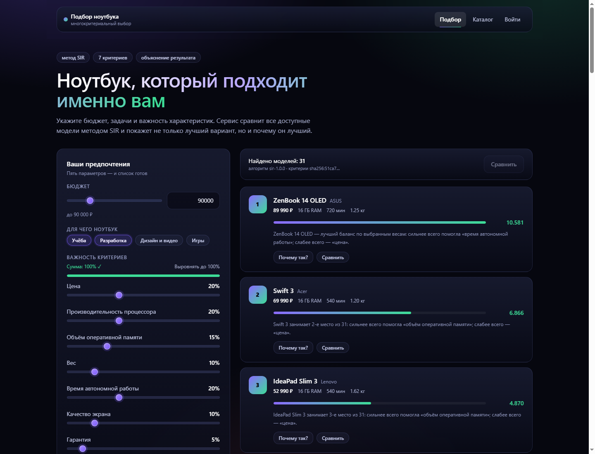
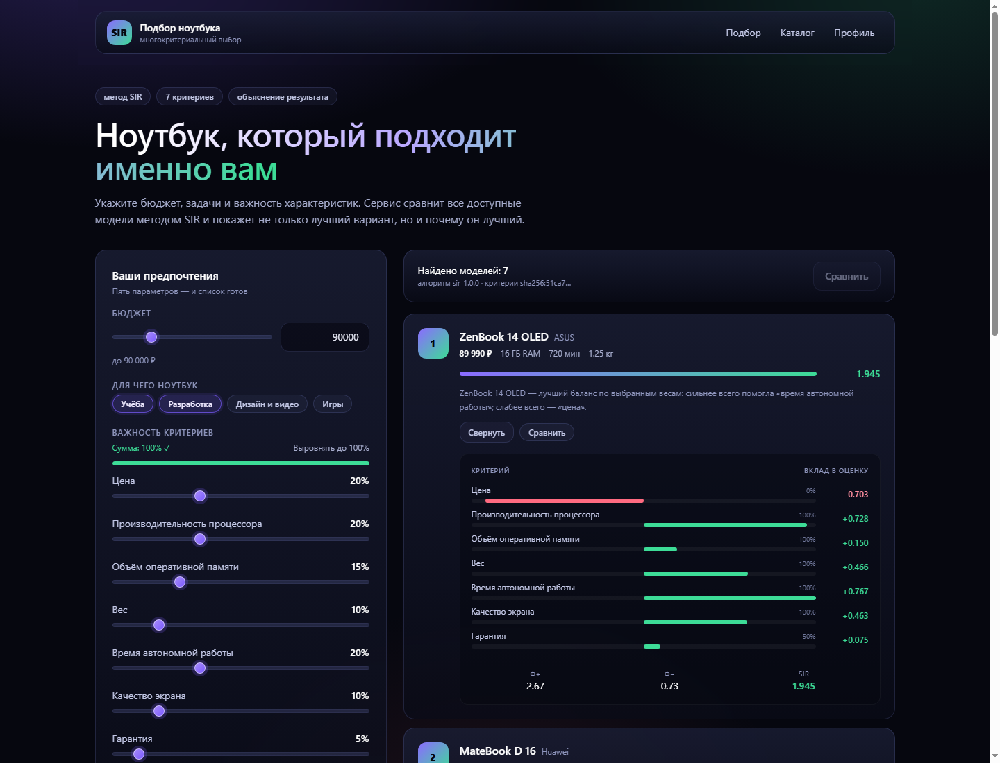
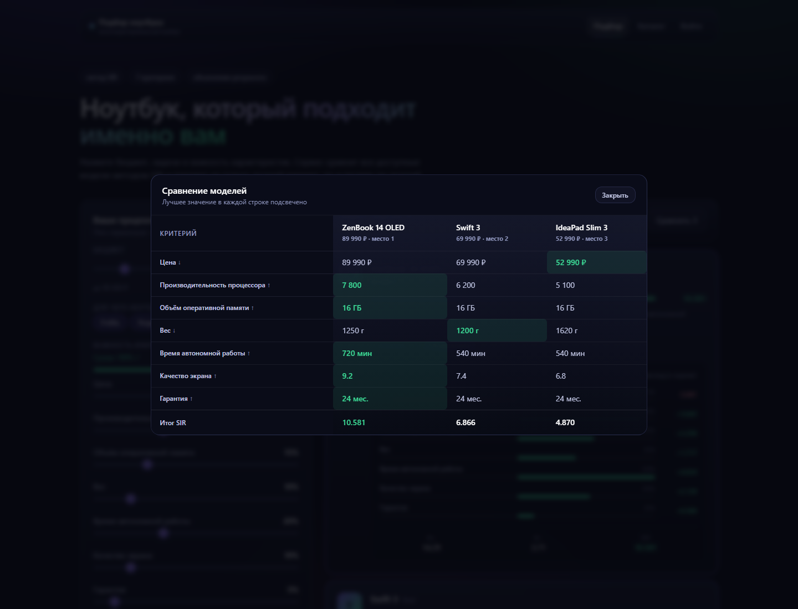
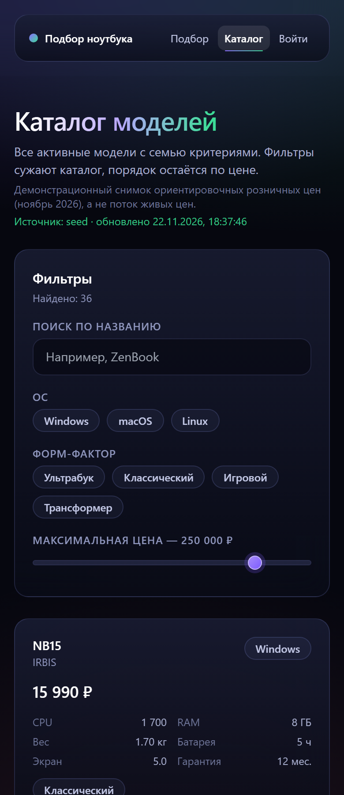

# Laptop Selection DSS — SIR service

Сервис поддержки принятия решений для выбора ноутбука методом SIR
(Superiority and Inferiority Ranking) по семи критериям, с объяснением каждого
результата и воспроизводимыми ранжированиями.

Feature: `specs/001-sir-laptop-selection/` (spec, plan, research, data model,
API contract, tasks).

## Current implementation status

| Area | Status |
|------|--------|
| Criteria registry (`shared/criteria.json` + codegen) | Implemented |
| SIR kernel: reference `O(n²·m)` + vectorized `O(m·n log n)` | Implemented, equivalence tested at `1e-9` |
| Backend API: catalog, auth, profiles, rankings, replay, comparison, admin | Implemented |
| PostgreSQL schema + versioned SQL migrations | Implemented (`backend/migrations`) |
| In-process event bus with idempotent replay (`processed_events`) | Implemented |
| Executable acceptance checks (28, incl. HTTP against PostgreSQL) | **Passing** (see `docs/validation.md`) |
| Catalog | 36 models, **15 990 – 199 990 ₽**, indicative retail snapshot |
| Domain statement coverage | **96.3%** (gate 80%) via `make coverage` |
| Browser tests | **4/4** Playwright scenarios on system Edge (`make e2e`) |
| Performance: 5 000 models ranked in ~220 ms (p95 261 ms) | **Passing** (`backend/tests/perf/`) |
| Next.js 15 frontend (US1–US4: ranking, details, compare, catalog, profile) | **Implemented** — `next build` passes; verified in headless Edge |
| UI quality gates (tsc, ESLint) | `tsc --noEmit` passes; ESLint not installed offline |
| ruff / mypy / pytest gates | Configured, not run (packages unavailable offline) |

## Run it

Prerequisites: Python 3.12 with the packages listed in `backend/pyproject.toml`,
and a PostgreSQL 16 database. Any PostgreSQL works; point `DATABASE_URL` at it.

```bash
cp .env.example .env                 # set DATABASE_URL and SECRETS
export PYTHONPATH=backend/src
python -m laptop_dss.shared.adapters.db   # or: make migrate
python -c "from laptop_dss.main import seed_demo; print(seed_demo())"
python -m uvicorn laptop_dss.main:app --app-dir backend/src --port 8000
```

OpenAPI: <http://127.0.0.1:8000/docs>. Health: `/api/v1/health`.

### Run the UI

```bash
cd frontend
npm install          # see frontend/README.md if the registry is slow
npm run dev          # http://localhost:3000, proxies /api to :8000
```

Production: `npm run build && npm start`. The UI is Russian-only, responsive from
390 px, and screenshots of the flow are listed in `docs/validation.md`.

Demo maintainer comes from `SEED_ADMIN_EMAIL` / `SEED_ADMIN_PASSWORD`
(defaults `admin@example.com` / `admin-password-12`; change them).

## Real-time catalog

Prices can be pulled from a live source at runtime; CSV and the bundled seed remain as
fallbacks. Sources are tried in order, and a failed refresh never empties the catalog:

1. `CATALOG_LIVE_URL` — JSON feed (`CATALOG_LIVE_ITEMS_PATH` + `CATALOG_LIVE_FIELDS` mapping)
2. `CATALOG_HTML_CONFIG` — path to a CSS-selector JSON config for a page you may read
3. `CATALOG_CSV_PATH` — CSV export (offline fallback)
4. the bundled demo snapshot

```bash
make refresh-catalog      # or: POST /api/v1/admin/catalog/refresh as a maintainer
python -m laptop_dss.catalog.adapters.sources --live-url https://example/feed \
  --fields '{"brand":"brand","model_name":"title","price_rub":"price"}'
```

Every row stores `source` and `fetched_at`; `/models` exposes that as `meta` and the catalog
page displays it, so the UI never implies live data it does not have.

**Why a configurable source instead of a hard-coded shop:** retailers reject automated
requests from here — DNS answers `401`, M.Video `403`, Citilink fails certificate
validation — and scraping them would breach their terms. Point the service at an API or
feed you are allowed to read; CSV is the offline fallback.

## Verify

```bash
make test        # 28 acceptance checks; needs a reachable PostgreSQL
make test-unit   # SIR kernel checks only; no database required
make coverage    # domain statement coverage (stdlib tracer)
make e2e         # Playwright against the running UI
python backend/tests/perf/test_rank_5000.py   # performance budget check
```

The checks reset the `public` schema of the configured database. Point
`DATABASE_URL` at a scratch database.

## Reproduce the SIR result from the prototype notebook

```bash
curl -s -X POST localhost:8000/api/v1/rankings \
  -H 'content-type: application/json' \
  -d '{"budget_minor": 8000000, "goals": ["study","development"],
       "weights": {"price":0.25,"performance":0.20,"memory":0.10,
                   "weight":0.10,"battery":0.15,"screen":0.10,"warranty":0.10}}' | jq
```

The response carries `rank`, `net_score`, and per-criterion `normalized` and
`contribution` values; with the notebook's linear preference (`q=0, p=1`) the
order matches `_notebook/` within `1e-6`.

## Screens

| Ranking | Explanation |
|---|---|
|  |  |

| Comparison | Mobile |
|---|---|
|  |  |

## Architecture

```text
backend/src/laptop_dss/
├── shared/      # ids, money, errors, clock, db pool + SQL migrator
├── catalog/     # criteria registry, DeviceModel, catalog reads/admin
├── profiles/    # WeightSet, users/sessions/profiles, auth use cases
├── ranking/     # SIR reference + vectorized engines, rank/compare use cases
└── api/         # schemas, dependencies, routes, app factory in main.py
shared/criteria.json   # the single authored criteria definition
frontend/              # generated criteria types only (app not built)
```

## Known deviations from the plan

1. **Persistence stack**: the plan specified SQLAlchemy 2 async + Alembic. This
   environment has no package index, so the adapters use `psycopg2` and a small
   versioned SQL migrator (`backend/migrations/*.sql`). The repository boundary
   is unchanged, so swapping in SQLAlchemy/Alembic later touches only adapters.
2. **Frontend scope**: Next.js 15 + TypeScript + TailwindCSS are used as planned, and
   `next build` succeeds. Components follow shadcn/ui conventions locally instead of
   pulling the shadcn CLI, and Framer Motion was replaced by CSS keyframes; both avoid
   another large offline dependency. No Playwright suite yet — the interactive flow is
   verified with a small CDP script (`frontend/scripts/capture.mjs`).
3. **pytest suite**: `backend/tests/unit/*` and `conftest.py` target pytest for
   CI, while `backend/tests/run_checks.py` is the stdlib runner used here.

## Security notes

Argon2id password hashes; opaque 256-bit session tokens stored only as SHA-256
digests; `HttpOnly; SameSite=Lax` cookie (Secure in production); ownership
resolved from the session only; Pydantic `extra="forbid"` on every write;
parameterized SQL throughout; explicit CORS allowlist; PII-free structured logs.
